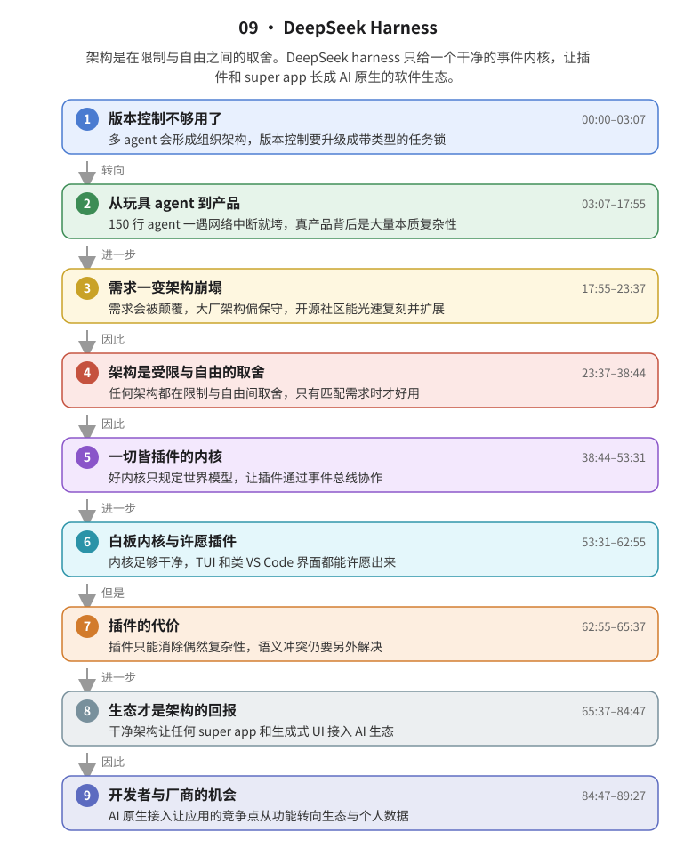

# 09 · DeepSeek Harness

> 原视频：<https://www.bilibili.com/video/BV144nc6KEA4>　·　课程合集：<https://space.bilibili.com/202224425/lists/8942017>　·　讲者：蒋炎岩（NJU《生成式软件工程》2026）

**一句话**：架构是在限制与自由之间的取舍。DeepSeek harness 只给一个干净的事件内核，让插件和 super app 长成 AI 原生的软件生态。

| # | 本节结论 | 话题 | 时间 |
|---|---|---|---|
| 1 | 多 agent 会形成组织架构，版本控制要升级成带类型的任务锁 | 版本控制不够用了 | [00:00](https://www.bilibili.com/video/BV144nc6KEA4?t=0)–03:07 |
| 2 | 150 行 agent 一遇网络中断就垮，真产品背后是大量本质复杂性 | 从玩具 agent 到产品 | [03:07](https://www.bilibili.com/video/BV144nc6KEA4?t=187)–17:55 |
| 3 | 需求会被颠覆，大厂架构偏保守，开源社区能光速复刻并扩展 | 需求一变架构崩塌 | [17:55](https://www.bilibili.com/video/BV144nc6KEA4?t=1075)–23:37 |
| 4 | 任何架构都在限制与自由间取舍，只有匹配需求时才好用 | 架构是受限与自由的取舍 | [23:37](https://www.bilibili.com/video/BV144nc6KEA4?t=1417)–38:44 |
| 5 | 好内核只规定世界模型，让插件通过事件总线协作 | 一切皆插件的内核 | [38:44](https://www.bilibili.com/video/BV144nc6KEA4?t=2324)–53:31 |
| 6 | 内核足够干净，TUI 和类 VS Code 界面都能许愿出来 | 白板内核与许愿插件 | [53:31](https://www.bilibili.com/video/BV144nc6KEA4?t=3211)–62:55 |
| 7 | 插件只能消除偶然复杂性，语义冲突仍要另外解决 | 插件的代价 | [62:55](https://www.bilibili.com/video/BV144nc6KEA4?t=3775)–65:37 |
| 8 | 干净架构让任何 super app 和生成式 UI 接入 AI 生态 | 生态才是架构的回报 | [65:37](https://www.bilibili.com/video/BV144nc6KEA4?t=3937)–84:47 |
| 9 | AI 原生接入让应用的竞争点从功能转向生态与个人数据 | 开发者与厂商的机会 | [84:47](https://www.bilibili.com/video/BV144nc6KEA4?t=5087)–89:27 |

## 1. 多 agent 会形成组织架构，版本控制要升级成带类型的任务锁

<small>▶ [00:00](https://www.bilibili.com/video/BV144nc6KEA4?t=0)–03:07　·　开场　·　话题：版本控制不够用了</small>

- **agent 时代不断更新基础概念，Git 已经不够用。** 软件工程、项目、项目管理这些概念太基础，所以每次变化都要重写它们。
    - **玩笑** 讲者说这些基础概念已经讲烦了：「我已经说了1万遍了我就不再说了」
    - 上周 Anthropic 说 Git 已经不够用。
    - 讲者在讲版本管理时就预告过，迟早会不够用，这很自然。
    - 上学时学 C++、Python、JavaScript，写自己的项目，是单线程的状态。
    - **玩笑** 讲上学时一个人写项目的状态：「我们上学你自己就是一个single thread agent」
- **人有了 agent 就成为 CTO，agent 之间会形成组织架构** 没有组织架构，就管不了复杂的需求。
    - 有了 agent，立即就拥有一个和现代公司一样的架构。
    - 人可以不写代码，底下有产品、UI、前端、后端多个 agent。
    - 每个 agent 可以带多个 sub agent，sub agent 还能再创建 sub agent。
    - 软件工程同时面对 essential complexity 和 accidental complexity，组织架构用来管理它们。
    - 仍然需要 repository，因为最终交付的是产品，要经过 CICD 上线。
- **每个 task 对应仓库的一块区域，要给它加带类型的锁** 从 first principle 想，task 一定和仓库的某些部分相关。
    - task 可能重构一个 Subsystem，或者加一个功能，会影响一些模块。
    - 不同 task 覆盖的范围不一样，在系统里的样子也不同。
    - 锁的类型包括 3 种：只读（read only）、写（write）、refactor。
    - minor fix 虽然是写锁，但不产生 breaking change。
    - 互相独立的 minor fix 可以并行执行。
- **锁的设计可以借鉴操作系统和数据库，具体方案从组织架构推出。** 两者的做法分别是悲观和乐观并发控制。
    - 操作系统先上锁再做，数据库先做再做 conflict detection（整理者补充：前者对应悲观，后者对应乐观）。
    - 讲者说答案会从组织架构上慢慢得出。

## 2. 150 行 agent 一遇网络中断就垮，真产品背后是大量本质复杂性

<small>▶ [03:07](https://www.bilibili.com/video/BV144nc6KEA4?t=187)–17:55　·　转向　·　话题：从玩具 agent 到产品</small>

- **150 行的 mini agent 能产出像样的成果，但不能当产品。** 它假设网络不会中断，一断线进程就终止。
    - mini agent 是上上节课的问答循环，几乎所有 agent harness 都是这个循环。
    - 大模型推理是一问一答，不管回答的是人还是工具。
    - **一句话让 mini agent 生成南大仙林校区三维图，结果大部分可用。** 讲者在高铁上用刚发布的新模型演示。
        - 提示词只有一句：要比例基本真实的南大仙林校区三维图。
        - 讲者是周日在高铁上突发奇想，想让 agent 做一个真正不简单的任务。
        - 这个任务耗时长，正好新模型发布。
        - 计算机楼应有十层，高度做错了。图书馆建模较好，俯视的几何形状正确。
        - agent 从 OpenStreetMap 爬取地图数据再建模，篮球场的线都能划出来。
        - 讲者上学时就发现 OpenStreetMap 是个宝藏，地图画得很细。
        - 地图上没有东西的地方被标成绿地，大门被建成楼，进门处铺满了树。
        - **吐槽** 讲者看着进门处铺满树的结果说：「你仔细看看，这可能不太好」。
        - 补救办法是让 agent 逐块划定区域、想清功能再精确建模，约多花 10 倍 token。
        - 网上演示图形能力强的新模型，也是这种方式。
        - 做法是用 skills 追着 agent 反复验证，用烧 token 换质量。
    - **三维模型可以当游戏的起点。** 指示 agent 标出哪里能走人、哪里能蹲点，就能构建游戏逻辑。
        - **玩笑** 讲者设想用这个模型做游戏：「我相信很多同学都梦想着做一个什么南大版的 GTA，然后你可以在里面身临其境地突突突突突」。
    - **断网让 150 行 agent 的成果作废。** 它已跑了较长时间并有中间结果，高铁断网后进程终止。
        - mini agent 没有会话保存、恢复和断网重试。
        - 讲者只能从零开始让它继续，或者重做一遍。
        - 讲者说 mini agent 在课堂上给大家玩一把肯定可以。
        - 只有一两轮对话时，感受不到断网问题。
        - **吐槽** 讲者说断网时它出了状况：「我在高铁上的时候，他给我来了这么一出」。
- **真产品必须处理网络中断，这类本质复杂性无法避免。** 重试策略要看网络环境，订单状态还可能未知。
    - **API 中断后的重试没有统一答案。** 超时和重试间隔都要按环境来定。
        - **玩笑** 讲者比较两种网络环境：「你在美国的数据中心访问 OpenAI 的服务，和你在中国挂上了 1 万层梯子访问 OpenAI 的服务，那是不一样的网络环境」。
        - 两种环境的 timeout 不同，连接中断多久算断也不同。
        - 失败后重试，可以等间距，也可以逐渐拉长间隔。
        - exponential backoff：1 秒后失败，再过 1 秒大概率仍失败，所以等 2、4、8 秒。物理世界的故障可能要等 2 到 3 分钟（字幕原文：223分钟，待确认）才恢复。
        - **吐槽** 讲者让 AI 总结这些问题，AI 又列了一堆：「他还说出了更多莫名其妙的东西」。
    - **客户端和服务端状态可能不一致，订单会进入未知状态。** 例子是支付。
        - 客户端发起支付，服务端收到就下单。它要和银行或航空公司确认，不能等客户端收到后才 commit。
        - 服务端有复杂架构，能可靠地完成订单。
        - 请求发出后手机断网，应用不能 crash，要转圈并告知网络中断。
        - **玩笑** 讲者替手机应用说话：「哦，网络中断了，所以你现在这个订单处于一个我不知道的状态」。
        - 订单可能下成功，也可能失败，但没有同步，客户端无法判断。
    - 这些都是 essential complexity，没有办法避免。
- **真产品还要管项目、沙箱和权限，需求说明书随之变长。** 讲者让 AI 假装做 WorkBuddy，写出的需求覆盖多个方面。
    - 项目管理：agent 同时在多个工作目录工作，需要 dashboard 切换项目，并访问各项目的工具和 skills。
    - 沙箱与权限：工具调用需要沙箱和权限，对应 coding agent 询问是否批准的设计。
    - **AI 写出的说明书包含场景、用例和需求清单。**
        - 设定：老板要公司出产品，参照卖得最火的 agent。调研 DSH 和 WorkBuddy，WorkBuddy 卖得最多，就做 WorkBuddy。
        - **玩笑** 讲者模仿老板下令：「谁卖得最多？WorkBuddy 卖得最多，好，你就去做一个吧」。
        - 讲者说 DSH 走的设计路线和 AI 写的完全不同。
        - 但 AI 确实想到了一些有趣的点。
        - AI 先想典型场景，例如把文件夹里的本周项目记录整理成周报，列出延期事项，生成 Word 文件。
        - 周报例子是普通人常见的 Word 管理场景。
        - 需求点包括 6 项。前两项是历史检索与任务复用，模板与偏好。中间两项是执行预算与用量，账号与数据管理。最后两项是外部内容与指定隔离（字幕原文：指定隔离，待确认），用户反馈与问题诊断。
        - 实际还有更多功能，以及非功能性需求。
- **把需求清单直接交给 agent 会陷入 slop，应先做 MVP 验证假设。** agent 倾向直接完成任务，不去想未来会发生什么。
    - slop 是 agent 只求交差、草率堆出的低质量成果（整理者补充）。
    - **吐槽** 讲者说 agent 只想完成任务：「他不会动动脑子去想到底未来还会发生什么」。
    - 产品和 MVP 不同，MVP 能让你看到产品的真实需求。
    - 使用 MVP 时假设会不断被验证。mini agent 假设网络和 API 稳定，假设不成立后需求相应增多。
- **讲者顺带讲了 4 件和主线无关的事。** 内容是选 DSH 的原因、本课范围、skill 的使用体会和许愿式运行。
    - 讲者说概念讲得差不多了，回到具体项目，看设计一个产品的整个流程。
    - 他选了 agent native 时代的产品 DSH。
    - 前天讲者在北京参加 DSH 线下聚会。参加的学生多是对着 web 许愿编程，几年后可能成为核心开发者。
    - **玩笑** 讲者拿自己和这些学生对比：「写过很多代码，然后也经过古法编程时代」。
    - 本课讲需求、架构、系统设计和在 DSH 上二次开发。下节课讲 agent native 开发的细节，因为 DSH 里有很多 CI/CD。
    - **skill 说起来简单，真用起来有坑，建议自己摸索。**
        - 网上有很多 skills，例如 grill-me 和 superpowers。
        - grill-me 的追问会陷入你不想管的事，面对未知时更明显。
        - 有的 skill 会反复派出 sub agent，做不必要的测试或 validation。
        - 讲者说这些做法在公司真开发产品时可能成立。
        - 他已把编译好的 DSH 准备好，让大家亲自摸索。
        - **自嘲** 有同学在评论里说上节课讲了很多却像什么都没讲：「看起来好像什么都没讲，确实是这样的」。
    - 许愿式运行：讲者部署编译 DSH 全靠对 agent 说愿望，只要知道项目可以编译。
        - 没有 LLM 的时代，运行复杂开源软件都很困难。
        - 讲者从昨天到今天，在本机部署和外部配置全是许愿式。
        - **自嘲** 讲者说自己连运行都靠许愿：「我现在完全就是许愿式运行」。

## 3. 需求会被颠覆，大厂架构偏保守，开源社区能光速复刻并扩展

<small>▶ [17:55](https://www.bilibili.com/video/BV144nc6KEA4?t=1075)–23:37　·　进一步　·　话题：需求一变架构崩塌</small>

- **需求被颠覆时，旧交互假设整体崩塌，大厂只能等下一版。**
    详尽需求和已上线的代码都建在旧交互上，大厂为保交付质量选了保守架构。
    - 讲者说设计 agent harness，真正的挑战是需求的改变。
    - 开发者按 WorkBuddy 办公场景写了详尽需求：左边栏是项目，右边栏有几种视图。agent（字幕原文：ADA，待确认）写了 50 万行代码并上线。
    - Clawbot 突然流行。它把 agent 当人，每个 agent 有自己的记忆，可以拉群协同，也可以定时做事。
    - 老板若说下一版按 Clawbot 做，旧需求里的交互根基全部崩塌。
    - **玩笑** 讲到老板改需求：「什么叫你怎么杀死一个程序员，你只要改需求三次就可以了，对吧」
    - 大厂架构能把上一版的性能和功能做到极致，但要保证高质量交付，所以偏保守。
    - **吐槽** 讲到大厂遇到摧毁性需求：「就必然要开始疯狂拉通对齐这个闭环沉淀复用，最后再到下一个版本，这没办法」
- **开源社区能光速复刻新交互，还能往外扩展**
    不止一人发布了 DSH bot，讲者说它像素级复刻了 Clawbot。
    - 复刻内容：可以设置多个 bot，可以拉群，群有类似群的图标，可以聊天。讲者说自己没装过。
    - **吐槽** 讲到复刻出的群图标：「甚至这个群还有一个像群一样的图标，非常真实」
    - Clawbot 面向普通人，不开放配置和编辑权限。程序员想自己改配置文件（字幕原文：configure点YM，待确认）和 prompt，而 99% 的人不知道怎么跟模型对话。
    - 讲者说 Clawbot 是很成功的产品。不满意，可以 vibe 加别的功能。
    - **老板视角 dashboard 是一个可能的扩展方向。** Clawbot 本质是在构建组织架构。
        - 用户当 CEO，向 CTO 交代任务，任务逐级往下分。
        - **玩笑** 讲到只和 CTO 对话：「你每次只要和项目组或者你的CTO你就可以做CEO了」
        - 左边栏改成树状的部门结构，聊天区压缩变小。
        - 目的是让用户有老板的沉浸感和体验感。
        - **玩笑** 讲到老板视角界面：「你有一个老板视角，好像自己坐在办公室里，对吧，给你提供一点情绪价值」
        - 讲者说这类需求提出后，立刻就会有人去 vibe。
- **DSH 从 2026 年 6 月 10 日晚上 11 点的空项目起步。目标一开始就是内核。**
    首次提交里没有代码，但有 MVP requirement analysis 和 microkernel architecture。
    - 讲者说 6 月 10 日时，大家已意识到 coding agent 要变天。
    - 当时主流产品有 Claude Code、OpenCode 和字节系的 CodeBuddy，WorkBuddy 还没有。讲者后来知道两者共享整个 agent 编排层。
    - **吐槽** 讲到首次提交的时间：「谁说 DeepSeek 不加班的，对吧」
    - 项目里连 CLAUDE.md 都没有。同时支持多种 agent 时，要用它们都理解的方式组织项目文件，讲者称这是恶心的需求点。今天已不需要它。
    - **吐槽** 讲到 CLAUDE.md 的需求：「这也是一个很恶心的需求点」
    - 讲者说开发者第一天就想做操作系统，「想造一个航母」。怎么造要回到架构（见第 4 节）。

## 4. 任何架构都在限制与自由间取舍，只有匹配需求时才好用

<small>▶ [23:37](https://www.bilibili.com/video/BV144nc6KEA4?t=1417)–38:44　·　因此　·　话题：架构是受限与自由的取舍</small>

- **需求直接画出的架构能并行开发，但锁死未来的自由** 模块边界让每个模块独立开发。需求一变，边界就成了阻力。
    - **agent 对着需求文档，会自然画出 class 式架构。**
        - 需求里有「工作区」，agent 就为它建 class，因为没有架构就算没完成任务。
        - **吐槽** 讲 agent 为何必须建 class：「因为他不能设计一个什么也没有的架构，就没有完成任务」
        - 工作区连到 session，session 向 agent 发 chat，agent 用 agentloop 或工具干活，把画布等结果放回 session。
        - session 的内容存进数据库。大厂也常这样设计。
    - 有了模块边界，开发一个模块时只需少量了解其余部分。第一天就按需求拆好模块，能立即启动大量 sub agent 把产品堆出来。
    - 代价是自由度受限。Clawbot 这类新需求出现时（见第 3 节），架构适应不了，就不断出现抽象泄漏，项目难以维护。
    - 架构意味着没有免费的午餐。DSH 的架构也一样，都在受限与自由之间取平衡。
- **限制太少的架构等于没有架构** 全进程发消息的 actor model 很自由，但没有约束，就没法开发。
    - 讲者设想有人嫌 class 式架构太典型，想做创新性架构。
    - 设想工作区、session、agent、UI 各是一个进程，进程之间只发消息。这个架构很干净，也很自由。
    - 讲者评价：这个架构没有用，它只是 actor model。它可能能实现，但没有规定消息怎么管理。
    - **吐槽** 评价全进程发消息的架构：「但这个架构没有任何用，他就是个 actor model」
    - class 式架构规定工作区与 agent 通过某个 API 或队列交互，例如 session 的 message 队列。接口定下后只能做这件事，容易开发。
    - 自由时，什么时候发什么消息都没确定，等于没有架构。越自由越难开发。受限有受限的好处，自由有自由的好处。
- **每个架构都在受限与自由间取一个点，没有两全** 操作系统、高级语言、LAMP、event sourcing 都付出了代价。
    - 操作系统的进程非常自由，上层能搭浏览器、coding agent、虚拟机。代价是人类为用什么语言开发吵了几十年。
    - **吐槽** 讲操作系统的自由带来的争吵：「我们就为了到底要用什么编程语言开发这件事情，人类就吵了几十年」
    - **玩笑** 讲到语言之争时：「现在我们好像这个老梗，就说 PHP 是最好的编程语言，已经见不到了……这个梗在我上学的时候还是非常流行的」
    - 高级语言里，C 能更好地控制机器，代价是内存泄漏等麻烦。
    - LAMP 是 Linux、Apache、MySQL、PHP 的整套单机架构，引领互联网至少十几年，WordPress 是典型。服务 1 亿、10 亿人时，从单机到数据库每一点都是瓶颈。拆开要先分库分表，再拆服务器，处处抽象泄露，最后演进到下一版架构。
    - **玩笑** 讲 LAMP 时再提这个梗：「PHP是世界上最好的编程语言」
    - **event sourcing 概念干净，但有代价，也有收益。**
        - 它把所有东西都当事实，只追加记录。其余人看到的都是事实的推导。
        - 当前状态完全由历史推导，性能更难做好。
        - 有时只想直接改当前状态。这要加一个特殊 event 和处理规则。它留在持久历史里会被审计，谁 commit 的一查便知。
        - 收益是解耦合和持久化，可以回退到任何历史版本。
    - **玩笑** 讲 event sourcing 难改当前状态时，举教务员强行毕业：「在一个月黑风高没有人知道的时候，然后悄悄的，你毕不了业的你就突然毕业了，对吧」
    - **玩笑** 模仿教务员被审计时的搪塞：「哎呀我也不知道那个时候是怎么回事」
- **MapReduce 用受限编程模型换来分布式容错，但只适合离线任务** 它用系统抽象解决机器不可靠。批处理之外就撑不住。
    - 2004 年 Jeff 和 SJ（字幕原文：jeff in和SJ，待确认）发表论文，某种程度上改变了 LAMP 中心化服务器的浪潮。讲者说这篇文章好读，看例子就行。
    - 论文标题是 Simplified Data Processing on Large Clusters。
    - **它规定程序只能写成 map 加 reduce。**
        - 做大规模分布式计算，不必写很长的代码，只要遵守这个受限模式。
        - 这是函数式编程的模式，Python 里也有。
        - map：用一个 function 把一个 list 变成另一个 list。
        - reduce：用 function F 依次合并元素。F 有结合律时，可以并行 reduce 两部分再合并。
        - reduce 前系统按 key 排序（shuffle）。系统实现藏在后面，用户不用知道。
    - 取舍是限制编程模型，换来只写简单程序。早期 Google 内部用 C++，include MapReduce 头文件，写 class 定义 map 和 reduce。在分布式文件系统上设最多 2000 台机器、每个 task 100 MB 内存，就自动在多台机器上跑完。
        - 写法像正常程序，但 pointer、list 这类基础抽象，换成了系统包裹的抽象。这些抽象可能跑在不同机器上。
        - 大家发现有了这层抽象，写分布式程序真的变容易，还能容错。
    - 容错：机器多了系统就不可靠。跑整个互联网的索引，几乎一定有一台掉线或出故障。LAMP 的基本假设是机器是好的，Google 不能靠社会工程，必须用系统抽象解决。
    - **玩笑** 讲同学大作业时机器会不会消失：「如果你的机器突然消失了，那你就摆烂了，你就跟老师说对不起老师我的……你用一个社会工程的方式解决这个问题」
    - 局限是只适合离线任务，用起来也不那么方便。处理即时数据、银行订单这类需求也走向分布式时，MapReduce 撑不住。今天的答案是 Spark 和流式处理的 Flink。
        - Flink 与 MapReduce、函数式编程都有千丝万缕的联系。
- **架构只在匹配需求时好用，假设变了就成为阻力** LAMP 在单机够用时最合适。新旧交替时需要更新的架构。
    - **人类社会的进步，是不断打破旧假设的过程。**
        - 新产业诞生，旧产业消亡，新旧交替时人才流转，有些人被淘汰，新人有了机会。
        - 例子有国企改革、房地产崩盘、AI 来临。互联网、云计算到 AI，每波浪潮都是架构变化。讲者小时候经历过多次。
    - **吐槽** 讲到旧产业消亡时顺口说：「老登们就被淘汰了」
    - AI 是产业超级加速器，变化会更有趣。这段由 AI 补充，细节在 slides 里。
    - 讲者以此引出 DSH：设计 agent harness 要问第一性原理。第一次提交写明要做 micro kernel，要做一个操作系统（见第 5 节）。

> 原话：「架构就意味着没有免费的午餐」

## 5. 好内核只规定世界模型，让插件通过事件总线协作

<small>▶ [38:44](https://www.bilibili.com/video/BV144nc6KEA4?t=2324)–53:31　·　因此　·　话题：一切皆插件的内核</small>

- **内核像操作系统，只管组合插件，不管插件做什么。** 操作系统不需要知道每个进程做什么，只负责把进程组合起来，并让进程互相使用。
    - Unix 诞生时，还没有桌面、浏览器和图形界面。操作系统不管进程是干什么的。
    - 一切皆插件（everything is a plugin）是 DSH 的 first principle。所有东西都能被插件解耦。
    - **插件像 actor model，但讲者说它不是 actor model。** 每个模块把 private state 封在自己里面，交互时发消息，收返回。
        - 把每个模块当进程，把函数调用换成远程过程调用，理论上能实现任意软件。
        - 所以只靠「模块之间发消息」这一点，架构没有用。
        - **吐槽** 讲者说任何软件都能变成这个样子：「所以这个架构是没有用的」
    - **Cordis 负责插件的依赖与生命周期，本节不展开它的论文。** DSH 先发了一篇叫 Cordis 的论文，里面有公式。
        - Cordis 负责服务解析、依赖激活、插件 load 和 unload。
        - 类比：DSH 是操作系统，插件是进程。进程退出时，操作系统回收它持有的所有资源。
        - 插件可以声明自己需要的依赖和 side effect。依赖自动加载，插件 unload 时依赖自动卸载。
        - 讲者类比：操作系统创建进程时分配内存，进程被 kill 时自动回收。
        - 讲者说这是理想情况，不可能所有 side effect 都能回收。
        - **玩笑** 讲者说操作系统会回收进程资源，大家默认了很久：「就像你们写 OJ 从来都不回收里面的内存一样」
- **协同才是难点，靠共享的世界模型解决，不靠随意发消息。** 插件随便发消息，等于函数链接在同一个地址空间里，没有好处。不协同又没有用。
    - **吐槽** 讲者说随便发消息和普通函数调用没区别：「就跟我说每一个都是一个函数链接在同一个地址空间里面没有任何的区别」
    - DSH 有一个所有插件共享的空间，关键数据结构都存在这里。
    - DSH 没有特权内核，所有东西都是 Cordis 插件。但插件之下还有更细一层的世界模型，比如 session。
    - **session 的事件日志是唯一事实。** LLM agent 以大模型为中心，所以 session 围绕模型设计。
        - session 只追加，事件日志是唯一的 ground truth。
        - 模型的历史不单独存储，从 derive messages 派生。
        - 这就是 event sourcing。其他能力都在这份持久历史上长出来。
    - 讲者列出几个针对 LLM 的抽象：session 是事件列表，agent 接收输入并推动执行，UI slots 用来装配。有了这些，WorkBuddy 里想实现的功能都能实现。
- **event bus 用类型限制谁能发什么，用 hook 让插件改写事件** 事件是扩展点，按领域分类。插件产生的事件都放到 event bus 上。
    - **类型约束像禁止任意往别人那边发消息。** 约束规定消息格式，以及谁能往 bus 上放东西。
        - 类型不匹配时，TypeScript 不会编译这份代码。
        - 另有 service 的 definition、provider、consumer，以及一系列权限管理。
        - **玩笑** 讲者用比喻说明这种限制：「就像禁止你任意的往别人那边发消息一样」
    - 插件可以监听某个事件，收到后还能修改事件本身。所以 DSH 像一个有原子能力的小操作系统。
    - 每个插件都能看到 LLM inference 的状态，比如这次吐出多少 token。
        - 模型输出不会立刻 commit。history 里有一个 open entry，新 token 不断送进去。
        - open entry 不 persist，但可以被看到，所以界面能实时显示思维链的变化。
    - **事件进入系统时就能被篡改，这是整套设计中关键的一环。** 插件不再只能先看，再推一个新事件。
        - 插件可以丢掉事件，或改写事件内容。
        - 例子：每轮对话都把时区和电脑指纹信息注入模型上下文。
        - **玩笑** 讲者举这个例子时随口调侃：「比如 Anthropic 要干坏事，你的电脑的一些指纹信息」
        - 做法一：写进需求说明，在 build context 里直接写。讲者的 150 行 agent 就有 build context。
        - 做法二：在 agent 的 PreStep 之前挂一个 hook，改掉内容。
- **干净的世界模型让插件不侵入内核，就能长出新功能。** 内测版是白板，第一天开发者群的同学就实现了 token 统计。
    - **Token 统计插件只观察，不干扰系统其他部分。** 它是不侵入的功能。
        - 内测版本里没有这个功能，什么都没有。
        - **玩笑** 讲者形容内测版的空白：「他真的就是白板一块，什么都没有的白板一块」
        - 开发者群的同学第一天提出要做 token 统计和上下文统计。
        - 插件只监听 LLM 吐 token 的事件，更新自己内部的状态，统计 cost 和 cache hit。
        - 再通过 UI slots 这层抽象，把统计绑定到界面上的位置。
    - 插件把大部分 state 放在自己内部。只有希望别人看到的事，才以事件放到 event bus 上。
    - **聊天窗口和 trajectory 都是 session 的投影。** 窗口里的内容是从 message history 算出来的。
        - 不喜欢聊天窗口，可以把它设成不可见，换成自己的界面。
        - session history 有两种投影：给人看的 UI，给 developer 看的 trajectory。
        - 演示：让 agent 调用 bash，trajectory 里能看到工具调用的 payload、执行结果和额外信息。
    - 第一方必须把 event 和 session 设计好。这两处设计崩了，后面的 DSH 生态无法维护。
    - 概念体系建好后，插件绝大多数时候只消费少量不侵入的事件，虽然它们有侵入的能力。
    - **玩笑** 讲者回忆 DSH 发布时自己的反应：「我当时看完就说，震惊，瘫坐，原子弹爆炸。大家可能没有意识到，一个干净的架构可以给我们带来什么」
- **协作接口只有少量几个，却覆盖 agent 的常见操作** 插件挂在总线上，状态留在本地，只靠少量接口协作。
    - API 看起来平常：在 session 上 append，注册某个 event 的 handler，在 event bus 上监听。
    - 投影接口：session.deriveMessages 从持久历史导出消息，也能导出 agent trajectory 和 chat。讲者说光这些功能就很好用。
    - **向 agent 提交输入有 3 种操作：follow up、inject、steer。** 用过 agent 产品的人都见过。
        - 例子：用 Codex 时，模型正在推理输出，用户可以继续提问。
        - 新提问有 3 种处理方式。等这一轮工具全部完成后再 inject。
        - 或者在下一次工具调用之后，即一轮 chat completion 或 response 之后，立即注入新 prompt。
        - 或者用户按 ESC 停下，再重新来。
    - 插件还能持续贡献动态上下文，并通过 context.on 和 session.event hook 还没 persist 的事件。
    - 每个插件都能感知全局的 agent loop、session 和各种 projections，按需得到 LLM inference 的进展，以及其他插件做了什么。

> 原话：「这个设计它的一切都是为了插件的生态」

## 6. 内核足够干净，TUI 和类 VS Code 界面都能许愿出来

<small>▶ [53:31](https://www.bilibili.com/video/BV144nc6KEA4?t=3211)–62:55　·　进一步　·　话题：白板内核与许愿插件</small>

- **内核足够干净，TUI 只需丢掉 UI slots 就能实现** 终端界面只监听 event bus 上的 session 事件，web UI 不用改。
    - trajectory 是第一方发布的朴素特性，对开发者 debug 很有用。地基打好后，做任何东西都容易。
    - DSH 原生设计是 web UI，里面有装配界面的 UI slots。TUI 把所有 UI slots 扔掉，只保留 session 和 agent。
    - TUI 在 event bus 上听全部 session 事件，包括 chat completion 正在吐 token 的过程，再投影到自己的终端。
    - TUI 可以和 web UI 共享状态。现场在一个终端输入 hi，另一个终端同步显示一模一样的输出。
    - 内测早期，官方仓库自带 TUI，后来被移除，现在有第三方 TUI。
    - PDF reader 同理，它 hook 生命周期事件。加载 tool 时，它把自己 inject 进去，以 event 方式管理。
    - **玩笑** 「但如果你偏偏要剑走偏锋，你说我就是不喜欢 web，我就是喜欢在命令行里面」
    - **玩笑** 两个终端同步演示完，讲者点评：「一个非常舒服的 TUI」
- **类 VS Code 界面也能用插件许愿出来，且不与生态冲突** 它只观察主 session，自己维护界面状态。
    - 听众可能觉得 Codex、Open Code 都长一个样。讲者说插件能做任何事，包括把 DSH 伪装成 VS Code。
    - VS Code 的基本假设是一个工作区对应一个目录。左边栏可动态配置多个小块，包括 editor 和 browser。
    - VS Code 左边栏的各个小块，本身也可能有自己的插件生态。
    - 一个插件可以维护多个 UI 块的状态，这是插件自己的事。底部放 terminal，体验和 VS Code 一样。
    - 打开一个工作区这类操作，也可以用插件的方式来管理。
    - 这个界面主要是聊天窗，像 Cursor 的 agent mode。它不断看主 session，所以不与生态里其他东西冲突。
    - 开发者还能再加 git、side chat 和第二个 chat。开发者用许愿的方式，就能得到想要的东西。
    - **吐槽** 讲者模仿听众的想法：「这不就是一个 Codex、Open Code，全部都长这样吗？我们还能干什么呢？」
    - **玩笑** 讲者指着屏幕上的成品：「这不就是个 Cursor，就是那个 Cursor 的 agent 的 mode 吗」
- **creator mode 把 Cordis 权限交给 agent，白板是核弹** agent 运行时可以动态增删插件。
    - WorkBuddy 这类产品先定好需求，请所有人在它的需求里工作。creator mode 给出 Cordis 权限。
    - 普通 agent session 只有 agent 权限：工作区目录读写和 Bash，后面可能再套沙箱。
    - 全火力的 creator mode 能看到整个世界。它可以拆插件、加插件，在 agent 运行时往 event bus 上挂东西。
    - 这个能力来自 Cordis 全动态的插件生命周期。类比操作系统：随时启动进程，随时杀掉进程。
    - 讲者说 creator mode 才是释放插件生态和好架构真正能力的地方。
    - 「许愿式插件」的想法催生了 creator mode。它的设计理念和普通产品不同，对创造者是真正的能力。
    - **玩笑** 「所以你看起来它是一个白板，但实际上它是一个核弹」
- **现场许愿改 token 显示，高权限操作要用户点允许** 讲者当场让模型改插件，过程中弹出权限请求。
    - 讲者对现在的 UI 不满意，许愿在 token 消耗旁边放一个超大号的显示（字幕不完整，待确认）。为了快，他把思考强度调低。
    - Token usage 插件靠事件实时统计推理速度。早上约 200，现在到 250（单位字幕未说，应为 token/s，整理者补充）。
    - **玩笑** 模型开始长时间思考，讲者解释为什么先调低思考：「虽然 DeepSeek 也有这种雷霆大思考的倾向，所以我把思考调低了」
    - **演示中出现 3 个插曲。** 每个都由插件管理。
        - 上下文有些污染，讲者说「有点糟糕」。
        - 新消息是立即放进去，还是 steer、排队，由插件决定，用户可以打断（见第 5 节）。
        - 模型要求安装 bundle（字幕：cod的install bule，待确认），讲者点 allow，随后又说不要了。
    - 讲者因为在上课，要求模型不要雷霆大思考，快一点。他说插件可以随意组合，但不是绝对（字幕不清）。
    - 除了实时统计，Token 插件还有很好的 dashboard。
    - 对不满意的地方，都可以动态改变这些插件的行为。
    - 讲者说「梁文锋时间」的推理速度比早上还要快（字幕不清，待确认）。
    - **玩笑** 讲者当场问听众：「所以你们有现在想要许个愿的吗」
    - **玩笑** 弹出危险权限请求后：「然后我就 allow 对吧，就真正的许愿式插件」
    - **自嘲** 「我因为我在上课，所以我就让他不要雷霆大思考，我要求他快一点」

> 原话：「所以你看起来他是一个白板，但实际上它是一个核弹。」

## 7. 插件只能消除偶然复杂性，语义冲突仍要另外解决

<small>▶ [62:55](https://www.bilibili.com/video/BV144nc6KEA4?t=3775)–65:37　·　但是　·　话题：插件的代价</small>

- **插件只统一了事件层，状态仍由各插件自己管理**：所有插件使用同一组事件，状态管理不归内核。
    - 讲者先立论：任何好处都有代价，这里的代价是状态没有统一。
    - **吐槽**：「所有的好处都是有代价的」
    - 事件类型不匹配的插件不能接入总线。
    - 状态留在插件内部。better sidebar 插件的窗口是什么、终端怎么表示，都在它自己里面。
    - 插件可以自建事件并推到 event bus 上，让其他插件看到。
- **插件之间的语义可能冲突，叠加后会互相干扰**。插件可以用 hook 改写同一份数据，内核不规定组合规则。
    - 上下文压缩插件把每次输出压到 1/2。加载 10 个就是 2 的 10 次方，约千分之一，信息全部丢掉。
    - 一个插件检查输入，另一个改写输入。检查在前还是改写在前，内核没有规定，取决于应用语义。
    - 一个 hook 要求停止，另一个要求继续。hook 运行到停止时，系统就被停掉。
- **插件只能消除偶然复杂性，语义冲突这类本质复杂性要另外解决**。冲突与应用语义相关，架构管不了。
    - 插件减少 accidental complexity，例如做动态 UI 生成时变得更容易。
    - essential complexity 永远不可能被插件解决。
    - 可能需要另加机制，例如 blackboard。插件在需要时通过它共享状态。
    - 加上 blackboard 后抽象泄露：插件不再只靠事件协作。
    - 讲者认为好架构仍会带来有趣的启发。

> 原话：「所以插件不是万能的，架构也不是万能的。」

## 8. 干净架构让任何 super app 和生成式 UI 接入 AI 生态

<small>▶ [65:37](https://www.bilibili.com/video/BV144nc6KEA4?t=3937)–84:47　·　进一步　·　话题：生态才是架构的回报</small>

- **架构的回报是整个软件生态，DSH 第一方只发白板。** 内核接口简单、对外开放，开发者可以在上面长出自己想要的东西。
    - 发布方式和前面的简化模型不同。简化模型是定需求、发布、赚钱。DSH 发布时只给基础抽象和少量第一方组件，其余交给开源社区。
    - 例子：上周北京有一场开发者自己组织的 OMMYDACH（字幕原文：OMMYDACH，待确认）活动。活动与官方无关，没有 DeepSeek 的人到场。讲者顺路去北京，到会场「闪现」了。
    - 讲者的判断：接口简单、复杂性低（字幕此处模糊，待确认），所以 DSH 上能长出一整个生态，「你想要什么就要什么」。
    - event bus 的真正能力是接入整个生态，不是 hook 事件来增强 UI 这类小东西。工具可以接进来，工具之间还能互相组合。
    - **吐槽** 讲者看社区做的东西，觉得开发者被带歪了：「开发者被带歪了。如果是我在第一方发 DSH，我不会用它来 vibe 一个什么高达驾驶舱，我显然会 vibe 一些更了不起的东西」。
    - **玩笑** 「只有这个吗只有这个吗，但他还在思考，好吧，行吧，那就认为这也是一个驾驶舱吧」
- **super app 加三个操作，就能接入 AI 生态。** 应用端做最小改造并加一个 bridge，就能用上 DSH 插件生态的全部好处。
    - 讲者第一个想接入的是 super app，只需要一个很小的抽象层。
    - super app 可能要改造，建议有 web UI。没有 web UI 也行，可以用 bridge 把它和 DSH 连起来。
    - **应用端只需支持三个操作。** 讲者以 WPS 做幻灯片为例。
        - 锁定：锁住一些对象，例如锁住第二页，别人不要再编辑。
        - 移交（hand off）：把锁住的对象从总线送进模型上下文。
        - 回收：把模型改好的对象从上下文取回，替换回 super app。
    - 讲者说 DSH 是一个很薄、什么也没有的内核层，底下有整个插件生态，这是 AI 的生态。他称这是「一个非常恐怖的能力」。
    - **画布 bridge 演示说明任何能嵌进网页的应用都能接入。** 讲者 5 分钟 vibe 出来，没有做 WPS，改用 Excalidraw 画布。
        - 先手动拖元素、写 hello。
        - 再让 AI 在框里画一只 turtle，用文本标签元素。
        - AI 工作时，用户可以照常编辑其他对象，被 AI 占用的对象处于锁定状态。
        - 结果：turtle 画出来了。龟壳不满意，可以再改或删除。讲者评价用的 DeepSeek flash 版本做得不错。
        - 讲者再切到聊天框，画 turtle 的 session 还在，高达驾驶舱依然生效。
    - 对比 Kimi 和 WorkBuddy：让它们做 PPT，产品团队还要自己做 PPT editor，支持拖框和加注释，再让模型改。讲者主张反过来做，把现成应用接进生态。
    - **吐槽** 讲者批评厂商自己重做编辑器：「这是一个生态，你直接把它摁进去就完了，真正的 AI native 的东西」。
    - bridge 放在总线上，整个生态都归它用。没有任何 AI 能力的应用，可以把任何对象以最合适的形式接入 AI。
    - 扩展：可以做 Blender 的 bridge。讲者拿它对比 MCP：只要一个很小的 protocol。它甚至可以成为 DSH 的原生插件，专做对象 bridge（此处字幕不完整，待确认）。
- **带 JS 的卡片让模型输出直接变成可交互界面。** 卡片里的点击和状态经 event bus 注回上下文，模型再指导界面更新。
    - **机制是 event bus 上 session 与模型的双向通道。** 这就是 generative UI。
        - 模型输出 HTML 加 JS 的卡片，卡片可以放到界面的任意 slot。
        - JS 里可放按钮、输入框，甚至 Excalidraw 或 WPS。讲者说理论上可以放复杂的 React component。
        - 允许部分 JS 往 event bus 注入事件，点击和界面状态就回到模型上下文。
        - 约定：模型输出带特定标记的 div（字幕：DSH.NMUI 的 DF，待确认），插件见到标记就渲染成卡片。讲者称这是「许愿似的」跟插件说要做这件事。
    - **成语接龙演示：点击按钮，JS 往上下文注入一句话。** 讲者同样用 5 分钟 vibe 出来。
        - 以「惊弓之鸟」开局。点击按钮后，JS 用字符串拼接把一句话注入模型上下文。
        - 模型接「鸟语花香」，再生成对界面的 patch。当前实现每次重新生成整张卡片，所以代码偏长。讲者说可以设计复用让它变短。
        - 状态能带着走。演示出现 bug，原因是讲者关闭了思考。后面接出「香火不绝」「绝处逢生」。
        - **自嘲** 「有些 bug，不要紧，因为我关闭了思考」
        - **吐槽** 「他不思考确实还是有些问题啊」
    - 五子棋：要求棋局状态放在 UI 里，所有落子由模型思考后完成。启用思考后，棋子落在了线上，讲者称这是 bug。
    - 动态 UI 可以搭配上下文压缩、上下文管理、上下文 fork 插件，省上下文。进一步可以不要聊天框，面对任务直接生成界面。
    - **ChatGPT 时刻类比：现在不成熟，但可能性说明一定能做好。**
        - 讲者回忆 GPT-3.5 时，让它从 50 数到 100，它输出「五十、五十一、五十一、五十一……」。
        - 当时觉得又慢又不好用。但看到它能做到一点，就意味着一定有办法做得非常好。
        - 讲者说这个 demo 肯定不是成熟产品，这就是架构的意义。
        - **自嘲** 「这肯定不是一个成熟的产品」
- **读插件源码，就能检验它有没有侵入内核。** 讲者先许愿得到效果，再让 agent 解释实现和对内核的入侵程度。
    - 建议：从 first principle 相信这件事做得到，然后大胆让模型去做。讲者也让 coding agent 解释整个应用怎样与 DSH 通信。
    - **画布 bridge 插件没有侵入内核。** 以下是 agent 分析源码的结论。
        - 它是 Cordis 插件，被 DSH 放进宿主进程。
        - 工具调用不直接改画布，只暂存到 store。点 begin 生成 job，把选区 id 锁在画布上。
        - 应用端只是很薄的改造层，要支持对象的选择和锁定。
        - 对应关系：应用是 agent 宿主插件，画布等于 session，编辑请求等于 tool call，提交等于回合结束的 commit。它还能和其他插件组合。
    - **动态 UI 插件只在 system prompt 一处写入模型上下文。**
        - 插件有使用条件：模型必须输出带标记的 div，所以每个 session 都要注入提示词。讲者说也可以理解成做一个 DSL。
        - 它 hook context.system prompt 事件，插入 1.5KB 的协议说明。这是插件唯一写进模型上下文的地方。
        - 模型输出到 UI 状态：不新增消息类型，靠标记加投影（event sourcing）。输出结束后检查有无标记，有就改自己的状态，例如往某个 slot 插入界面。
        - 它依赖 Cordis 服务和 session projection 回调，还自带 library、浏览器 remote session、prompt 打包 profile。讲者说这些「有点入侵」，但底层架构没有改动。
    - 第三个插件只注册事件，旁听全局的 Assistant stream 事件，并做对象同一性过滤，不匹配的别人的 agent 不处理。它在后台启动 inference session，只取一个结果。DSH 用 scope 机制限制插件越界（见第 9 节）。

> 原话：「真正的架构给我们带来的，是一整个软件的生态」

## 9. AI 原生接入让应用的竞争点从功能转向生态与个人数据

<small>▶ [84:47](https://www.bilibili.com/video/BV144nc6KEA4?t=5087)–89:27　·　因此　·　话题：开发者与厂商的机会</small>

- **开发者会开出脑洞，厂商也可能介入** 大学生有时间折腾，讲者没有。
    - 群里多是大学生，经验少于讲者，但有时间折腾 web code。
    - 讲者见过很多软件系统的设计和实现，知道东西怎么用才能最大化发挥效能。
    - **吐槽** 讲者评价群里的开发者：「都是些无所事事的大学生，哎，我觉得这也挺好」
    - 脑洞可能很小：高达驾驶舱、更漂亮的 UI、better sidebar。
    - 更严肃的厂商也可介入，谁能赚钱看意愿，但全部 open source。
- **功能只有七八十%的原生 agent 应用，可能胜过 WPS** 接入后用户面对自己的 agent 和个人数据库。
    - 讲者愿意接受功能只有 WPS 七八十%、但原生支持 agent 的应用。
    - 用户面对的是个人 agent、个人数据库和顺手的工具。
    - 讲者自己用 agent 来管理个人数据库。
- **个人 database 插件让填表不用 computer use** 任务丢上总线，生态协作完成。
    - 例子：表格要填 2021 年至今发表的所有论文，用 WPS 或 Codex 的 computer use 填都费时。
    - **吐槽** 讲者说起这张要填的表：「那个表很讨厌」
    - 生态里接一个 database 插件，提供个人信息、论文、所管学生。
    - super app 把论文列表任务丢上总线，工具、电脑、记忆、bot 协作返回数据，一次填好。
    - 全程不用 computer use、截图和多余 token。
    - 讲者称这就是一个操作系统，很多事可以在里面从开始、处理到结束完整做完。
    - 这是讲者喜欢 DSH 架构的原因。
    - 讲者建议大家想一想这个思路，认为能做很多有趣的事。
- **讲者的 agent OS 与 DSH 思路相近，他预告根本变化** 同样 everything is a plugin。
    - 现在没有刻意组合各个插件，讲者说自己只是完全在许愿。
    - **玩笑** 讲者用核弹爆炸形容在 DSH harness 上看到的世界：「为什么说我看到了核弹爆炸」
    - 这个保密项目在 DSH 之下，可并行，提供更多能力；其上 super app 怎么设计，今天有今天的答案。
    - 讲者发过招人的帖子，保密项目就是 agent OS。
    - 讲者相信不久所有东西会发生根本变化。
    - 顺带：昨天小红书帖子因保密被迫删除；下节课讲 DSH 的 agent native 开发。

## 提到的资料

| 名称 | 是什么、为什么提 | 小节 |
|---|---|---|
| Anthropic | 讲者说它上周提出 Git 在 agent 时代已不够用 | 1 |
| Git | 主流版本控制工具，讲者认为多 agent 场景下不够用 | 1 |
| DeepSeek harness | 讲者选来演示产品设计和二次开发的 agent native 产品 | 2 |
| OpenStreetMap | 开放地图数据源，mini agent 用它建南大校区模型 | 2 |
| WorkBuddy | 办公 agent 产品，AI 假装对标它写需求说明书 | 2 |
| grill-me | 追问式 skill，讲者说它会陷入不想管的事 | 2 |
| Superpowers | 流行的 agent skill 集合，讲者说要自己摸索 | 2 |
| Clawbot | 把 agent 当人、可拉群的新交互产品，讲者用它举例需求颠覆 | 3 |
| CodeBuddy | 字节系编程 agent，当时已有的主流产品之一 | 3 |
| DSH bot | 社区按 Clawbot 交互像素级复刻的 DSH 应用 | 3 |
| Claude Code | 2026 年 6 月已有的主流 coding agent 产品 | 3 |
| OpenCode | 同期主流 coding agent 产品 | 3 |
| CLAUDE.md | 多 agent 项目需统一组织文件时的麻烦需求点 | 3 |
| MapReduce: Simplified Data Processing on Large Clusters | 2004 年论文，用 map 加 reduce 的受限模型做分布式计算 | 4 |
| WordPress | LAMP 架构的典型应用 | 4 |
| Spark | MapReduce 之后的计算引擎，应对更广的需求 | 4 |
| Flink | 流式数据处理引擎，处理即时数据 | 4 |
| Cordis | DSH 先发的论文与插件内核，管服务解析、依赖激活和插件加载卸载 | 5 |
| Unix | 类比：操作系统不管进程做什么，只组合进程 | 5 |
| Codex | 例子：模型推理时可继续提问，引出 follow up、inject、steer | 5 |
| TypeScript | 事件类型不匹配时拒绝编译，约束 event bus 上的消息 | 5 |
| VS Code | 讲者用它的工作区、边栏、终端布局，演示伪装成 VS Code 的插件 | 6 |
| Cursor | 讲者把类 VS Code 界面比作 Cursor 的 agent mode | 6 |
| Codex / Open Code | 讲者设想听众觉得插件只能做出这类界面 | 6 |
| better sidebar 插件（字幕原文：better side bar，待确认） | 例子：插件自己管理窗口和终端的表示 | 7 |
| blackboard（白板） | 让插件按需共享状态的另一机制，会造成抽象泄露 | 7 |
| DeepSeek harness（DSH） | 讲者的主题：只发白板内核，其余交给开源生态 | 8 |
| WPS | 讲者举的 super app 例子，可通过 bridge 接入 AI | 8 |
| Excalidraw | 画布应用，讲者用它演示 bridge 锁定、移交、回收 | 8 |
| Kimi / WorkBuddy | 讲者批评的做法：自己重做 PPT editor | 8 |
| MCP | 讲者拿来对比：只需一个小 protocol 做对象 bridge | 8 |
| Blender | 讲者设想的下一个 bridge 对象 | 8 |
| ChatGPT（GPT-3.5） | 类比：早期又慢又差，但可能性已显现 | 8 |
| OMMYDACH 活动 | 北京开发者自发组织的活动，名称待确认 | 8 |
| WPS Office | 举例：功能只有七八十%但原生接入 agent 的竞争对象 | 9 |
| Codex computer use | 举例：用截图操作电脑填表，耗时且费 token | 9 |
| better sidebar | 讲者称赞的开发者小脑洞插件 | 9 |
| agent OS | 讲者保密在做的项目，位于 DSH 之下，也以插件为核心 | 9 |

## 课程事务

- 下节课讲 DSH 里 agent native 开发的部分

## 术语表

| 术语 | 含义 | 字幕原识别 |
|---|---|---|
| DeepSeek harness（DSH） | DeepSeek 的开源 agent 外壳，以插件为核心 | depc harness、DPC harness、deep c harness、DEPSICK哈里斯、d pc harness |
| Cordis（拼写待确认） | DSH 的插件内核，管服务解析与加载卸载 | CORDIS、CORIS、CODIS、cortex |
| event bus | 插件之间收发事件的总线 | 一般bus、一般缩ING |
| event sourcing | 只追加事件日志，当前状态由历史推导 | 一般缩ING、event socing |
| creator mode | 给 agent 动态增删插件权限的模式 | create creator mode |
| Clawbot（拼写待确认） | 把 agent 当人、可拉群的交互产品 | GROWBOT、grab bot、GROUBT、grab board |
| WorkBuddy（拼写待确认） | 办公场景的 agent 产品 | Work body、work body、wake upbuddy |
| CodeBuddy（拼写待确认） | 与 WorkBuddy 共享编排层的编程 agent | cold body |
| DSH bot（拼写待确认） | 社区按 Clawbot 交互复刻的 DSH 应用 | d s h bot |
| MapReduce | 限制编程模型以换取分布式容错的框架 | map reduce |
| LAMP | Linux、Apache、MySQL、PHP 的单机架构 | Lamp、LINUXAPARTYMICOPHP |
| exponential backoff | 失败后重试间隔指数拉长 | exponential back off |
| super app（拼写待确认） | WPS 这类大型应用，可通过 bridge 接入 AI | super rap、SUPREP、SUFP |
| generative UI | 模型输出带 JS 的卡片来生成界面 | General generation ui |
| Excalidraw（拼写待确认） | 演示 bridge 所用的画布应用 | excelly door、EXCITOR、ex calida |
| OpenStreetMap | 开放地图数据源，建模南大校区 | open street map |
| grill-me（拼写待确认） | 网上流行的追问式 skill | grow me、grill v stocks |
| Superpowers（拼写待确认） | 流行的 agent skill 集合 | super powers |

---

<small>笔记由模型根据字幕整理，按主题而不是按时间分节。每节标题是这节的结论，每条粗体是它下面内容的结论：只读粗体也能读到全部核心论点。标「（整理者补充）」的是整理者补上的推理。引用前请对照原视频。</small>
